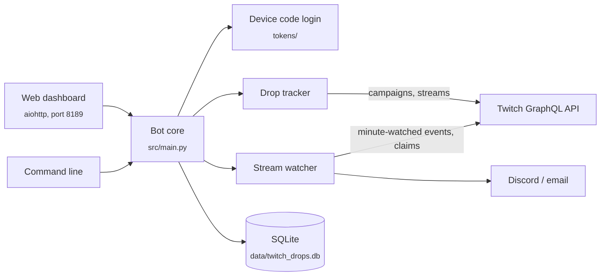

<div align="center">

# Twitch Drops Bot

**Earns Twitch Drops for the games you choose, from a local web dashboard.**

[](LICENSE)


</div>

Twitch Drops reward you for watching a game's streams for a set time. This bot finds active drop campaigns for the games you track, picks a live stream for each drop, reports watch time to Twitch in the background without playing any video, and claims the reward when it is ready. You control it from a dashboard in your browser, or from the command line.

## Features

- **Track games.** Search Twitch for a game and add it. Drag games into the order you want them watched.
- **Automatic watching.** Finds watchable drops, starts sessions for them and switches to another stream if the current one goes offline.
- **Automatic claiming** of finished drops, with a manual claim button as well.
- **Dashboard** with progress, an activity log, active campaigns, your drop inventory and a history of earned drops.
- **Notifications** to a Discord webhook or by email when a drop is earned or claimed, or when a new campaign starts.
- **Quality of life:** a first-run tour, light and dark mode, and an optional sound when a drop is claimed.

## Getting started

### Prerequisites

- Python 3.10 or newer. On Windows, tick **Add Python to PATH** in the installer.
- A Twitch account.

### Windows: one click

1. Download the repository as a ZIP and extract it, or clone it:
   ```bash
   git clone https://github.com/AlexMakesC0de/twitch-rewards-bot.git
   ```
2. Double-click **`start.bat`**. The first run installs the dependencies, then the dashboard opens in your browser. Keep the window open while the bot runs.

### Any platform

```bash
git clone https://github.com/AlexMakesC0de/twitch-rewards-bot.git
cd twitch-rewards-bot
python -m venv venv
source venv/bin/activate       # Windows: venv\Scripts\activate
pip install -r requirements.txt
python -m src.main ui
```

The dashboard runs at `http://127.0.0.1:8189` and opens automatically.

## Usage

1. **Log in.** In **Settings**, click **Login with Twitch**. You get a code to enter at the Twitch activation page. No Twitch developer app is needed.
2. **Add games** on the **Games** page.
3. **Let it run.** The bot finds campaigns, watches and claims. Check the **Dashboard** or leave it in the background.

| Page | What it shows |
| --- | --- |
| Dashboard | Overview, drop progress and activity log |
| Games | Tracked games and their priority |
| Drops | Active campaigns and your inventory |
| Watch | Live watch sessions and available campaigns |
| History | Drops you have earned |
| Settings | Login, theme, sound and notifications |

### Command line

Everything is also available without the dashboard. Run `python -m src.main` with no arguments to see the list.

```bash
python -m src.main login              # log in with a device code
python -m src.main add-game "Game Name"
python -m src.main check-drops        # list available drops
python -m src.main watch-auto         # watch all available drops
python -m src.main run                # full bot: monitor, watch, claim and notify
python -m src.main inventory
python -m src.main history
```

Other commands: `logout`, `remove-game`, `list-games`, `watch`, `status`, `claim`, `config-email`, `config-discord [url]`, `test-notify` and `ui`.

## How it works



- **Login** uses Twitch's OAuth device code flow with Twitch's own client ID, because the GraphQL API that exposes drops only accepts tokens issued to Twitch's first-party clients. The token is saved in `tokens/twitch_token.json`.
- **Tracking** asks the Twitch GraphQL API for drop campaigns of your tracked games and for live streams with drops enabled.
- **Watching** sends a `minute-watched` event for each session on a heartbeat (every 60 seconds by default). Video is never downloaded or played.
- **Storage** is a local SQLite database for tracked games, watch sessions, drop history and notification settings.

## Configuration

### Notifications

- **Discord:** in your server, open Server Settings > Integrations > Webhooks, create a webhook and paste its URL in the dashboard under Settings.
- **Email:** fill in your SMTP details under Settings. For Gmail, use an [App Password](https://myaccount.google.com/apppasswords). The email password is not stored in the database, so put it in `.env` as `EMAIL_PASSWORD` if you want email alerts to keep working after a restart.

Notification settings can also come from a `.env` file (copy [`.env.example`](.env.example)):

| Variable | Purpose |
| --- | --- |
| `DISCORD_WEBHOOK_URL` | Discord webhook URL |
| `EMAIL_SMTP_HOST`, `EMAIL_SMTP_PORT` | SMTP server (default `smtp.gmail.com`, `587`) |
| `EMAIL_SENDER`, `EMAIL_RECIPIENT` | From and to addresses |
| `EMAIL_PASSWORD` | SMTP password or app password |

`TWITCH_CLIENT_ID` and `TWITCH_CLIENT_SECRET` in `.env.example` are not used by the current login flow and can be left empty.

### Bot behaviour

[`config/config.yaml`](config/config.yaml) controls, among others:

| Key | Default | Meaning |
| --- | --- | --- |
| `check_interval` | `15` | Minutes between campaign checks in `run` mode |
| `watch_heartbeat_interval` | `60` | Seconds between watch events |
| `auto_claim` | `true` | Claim finished drops automatically |
| `max_concurrent_watches` | `2` | Drops watched at the same time |
| `auto_switch_streams` | `true` | Move to another stream when one goes offline |
| `notifications.*` | | Which events send a notification |
| `logging.*` | `INFO`, `logs/bot.log` | Log level and file |

## Project structure

```text
src/
  main.py            Entry point and command line
  auth/              Device code login and token storage
  api/               Twitch GraphQL and Helix clients
  drops/             Campaign tracker and stream watcher
  notifications/     Discord and email notifiers
  storage/           SQLite database
  web/               Dashboard server, template and static files
  ui/                Command line output helpers
config/config.yaml   Bot settings
start.bat            Windows launcher
```

## Disclaimer

This bot talks to Twitch's platform programmatically, and automated viewing may break Twitch's Terms of Service. Use it at your own risk; your account is your responsibility. It is a personal and educational project.

## License

[MIT](LICENSE)
